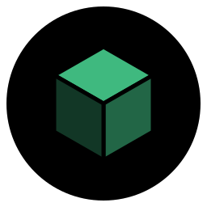
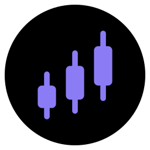
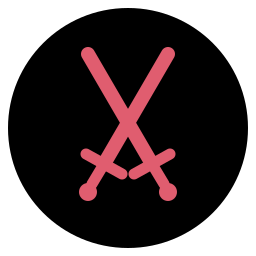

 

 

# opsor

### Software that works while you don't.

Quiet, precise automation. Built to run, built to last.

 

  

  

<a href="#why">Why opsor</a> &nbsp;·&nbsp; <a href="#services">Services</a> &nbsp;·&nbsp; <a href="#products">Products</a> &nbsp;·&nbsp; <a href="#stack">Stack</a> &nbsp;·&nbsp; <a href="#faq">FAQ</a> &nbsp;·&nbsp; <a href="#contact">Contact</a>

 

<h2 id="why">&nbsp; Why opsor</h2>

Most custom software arrives half-finished: no installer, no error handling, no docs. I build the whole thing, so what you receive is a product you can run, hand to a teammate and trust.

<table width="100%">
<tr>
<td width="25%" valign="top"> <b>Self-running</b> Reconnects, recovers and heals on its own.</td>
<td width="25%" valign="top"> <b>Secure</b> Encrypted credentials and audit trails.</td>
<td width="25%" valign="top"> <b>Tested</b> Unit, end-to-end and soak tests.</td>
<td width="25%" valign="top"> <b>Ship-ready</b> Installer, updates, docs, clean UI.</td>
</tr>
</table>

 

<h2 id="services">&nbsp; Services</h2>

<table width="100%">
<tr>
<td width="50%" valign="top">
 
<b>Automation & bots</b> 
Real-time clients and multi-account managers with safety logic built in.
</td>
<td width="50%" valign="top">
 
<b>Desktop applications</b> 
Windows app with installer, auto-update and a clean UI.
</td>
</tr>
<tr>
<td width="50%" valign="top">
 
<b>Orchestration & backends</b> 
Task queues, worker swarms and APIs that scale.
</td>
<td width="50%" valign="top">
 
<b>Dashboards & alerts</b> 
Live status, desktop and phone alerts, Discord and Slack webhooks.
</td>
</tr>
</table>

> **Open to any project**, as long as it is legal and does not break a platform's EULA or terms of service. If it fits, I will build it.

 

<h2 id="products">&nbsp; Products</h2>

| | Product | Type | Highlights |
| :-: | :-- | :-- | :-- |
|  | **AFK** | Multi-account automation | Run any number of accounts from one window. Self-care, death recovery, safe-logout and instant alerts |
|  | **Pilot** | Swarm controller | One brain and a lease-based task queue that builds a schematic across many bots, layer by layer |
|  | **MAS** | Team operations terminal | Millisecond scheduling, encrypted credentials, tamper-evident audit ledger, 184 tests |
|  | **Bat** | Fleet command console | Combat and PvP, tactical codes, a commander bot, live 3D map and an offline simulator |

Source is private. Live demos and walkthroughs on request. Bots are for servers you own or have permission to use them on.

 

<h2 id="stack">&nbsp; Stack</h2>

       

 

<h2 id="faq">&nbsp; FAQ</h2>

<b>What do you take on?</b>

 
Automation tools, bots, backends and Windows desktop apps, and any other project that is legal and respects a platform's EULA and terms of service.

<b>Do I get the source code?</b>

 
Yes, source handover can be part of the delivery. We agree on it in the scope.

<b>Is it safe for my accounts?</b>

 
Tools use official sign-in flows wherever one exists, and any stored credentials are encrypted. I flag a platform's rules before building.

 

<h2 id="contact">&nbsp; Contact</h2>

Describe what you need and I'll tell you what's feasible, how long it takes and what it costs.

  

Made by <b>opsor</b> &nbsp;·&nbsp; Custom software on request

