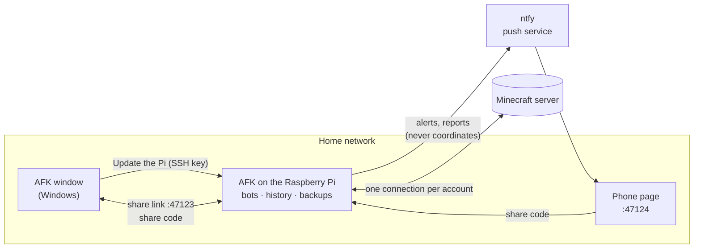

The bots live on the Pi. The window on your PC joins it, shows everything live and sends your clicks back, so closing the PC never stops a bot. The same AFK also runs the bots on the PC itself, without a Pi.

